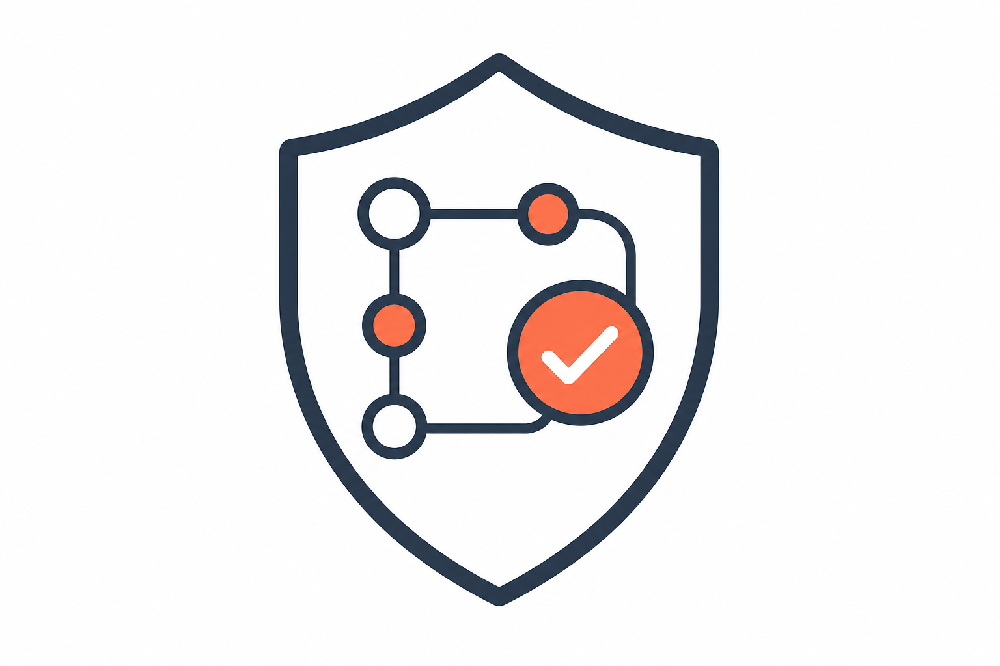

# Docker

{ width="280" }

A pre-built, distroless Wolfi image (Python 3.14, nonroot), published by
[MaturityBuilder](https://github.com/MaturityBuilder/gitlab-compliance). The
image is assembled with [melange](https://github.com/chainguard-dev/melange) and
[apko](https://github.com/chainguard-dev/apko) from locked Poetry dependencies.

`gitlab-compliance` is published on [Docker
Hub](https://hub.docker.com/r/maturitybuilder/gitlab-compliance/) as
`maturitybuilder/gitlab-compliance`.

```bash
docker run -it -v $PWD:/src -w /src -e GITLAB_TOKEN=$GITLAB_TOKEN \
maturitybuilder/gitlab-compliance check -f example-policies --include-nested \
--project <my gitlab project path>
```

## Audit Pipeline Yaml

```yml
gitlab-compliance:
    image: maturitybuilder/gitlab-compliance
    script:
        - gitlab-compliance check -f example-policies --include-nested --project
          <my gitlab project path>

```

Depending on your workflow and security policy the pipeline can potentially auto
resolve includes and image updates by passing `--fix` (alias: `--fix-supply-chain`).
Next: [Usage](../usage/index.md).
